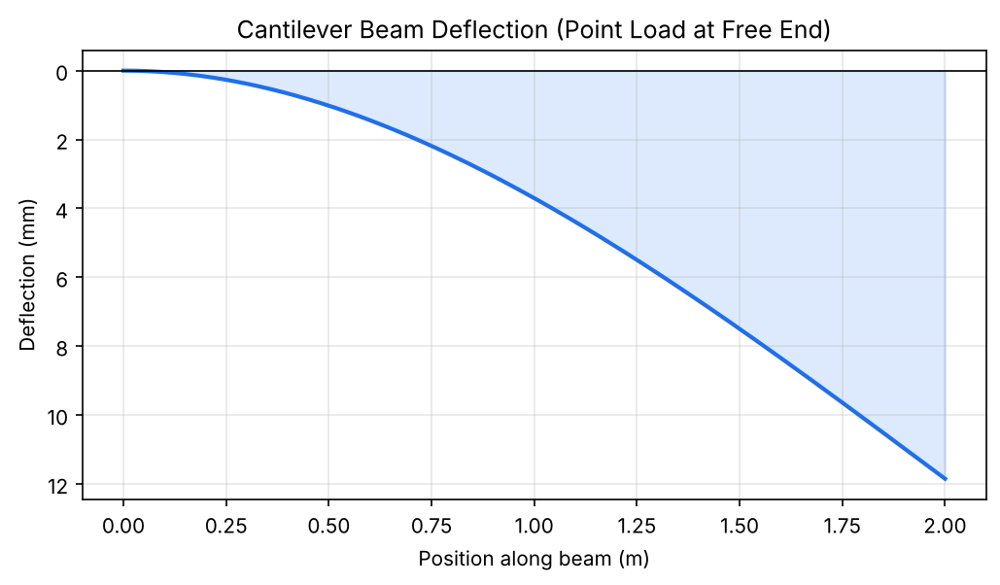
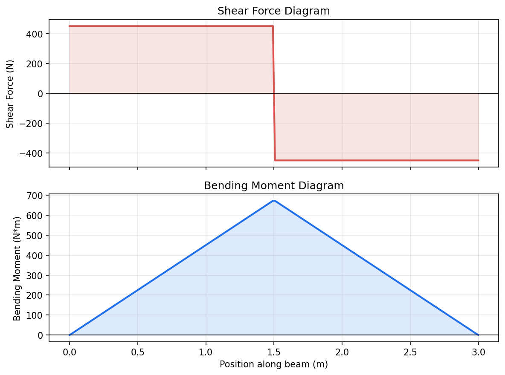
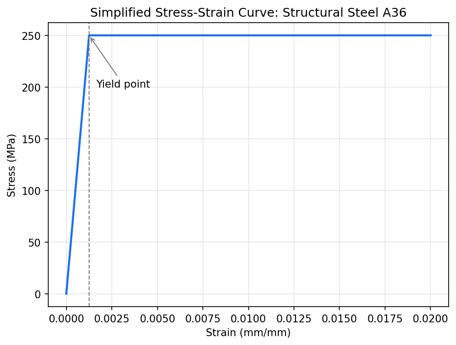
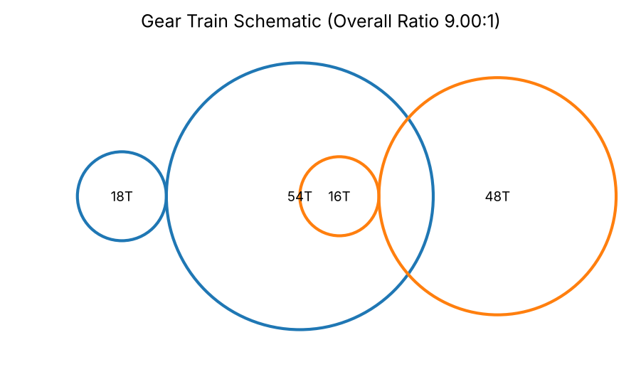

<div align="center">

<picture>
  <source media="(prefers-color-scheme: dark)" srcset="assets/readme/hero-dark.svg">
  <source media="(prefers-color-scheme: light)" srcset="assets/readme/hero-light.svg">
  
</picture>

<br>

[](https://github.com/Haneet10/Mech-Lab/actions/workflows/tests.yml)


**[Quick start](#quick-start)** &nbsp;·&nbsp; **[What it does](#what-it-does)** &nbsp;·&nbsp; **[See it run](#see-it-run)** &nbsp;·&nbsp; **[Plots](#plots-it-makes)** &nbsp;·&nbsp; **[Formulas](docs/theory.md)**

</div>

<br>

Mech Lab does the calculations you would normally grind through by hand in a mechanics or machine design course. Give it a beam, a gear train, a column or a bearing, and it tells you how much it bends, how stressed it is, how long it will last, and whether it is safe. Every answer is checked against a textbook formula in the test suite.

```python
from mech_toolkit import beam_calculator

I, c = beam_calculator.rectangular_section(width=0.025, height=0.060)   # 25 × 60 mm steel bar
beam = beam_calculator.cantilever_point_load(length=2.0, load=400, moment_of_inertia=I,
                                             section_modulus_c=c, material="Structural Steel A36")

beam.is_safe              # True
beam.factor_of_safety     # 4.69
```

<picture>
  <source media="(prefers-color-scheme: dark)" srcset="assets/readme/divider-dark.svg">
  
</picture>

## What it does

Eight modules, one job each. They share a materials database, so you can name a material like `"Aluminum 6061-T6"` instead of typing in its properties.

<picture>
  <source media="(prefers-color-scheme: dark)" srcset="assets/readme/modules-dark.svg">
  
</picture>

On top of those, `plotting` draws deflection curves, shear and moment diagrams, stress-strain curves and gear schematics, and `gui` wraps the beam calculator, gear calculator and unit converter in a small desktop app.

<picture>
  <source media="(prefers-color-scheme: dark)" srcset="assets/readme/divider-dark.svg">
  
</picture>

## See it run

This is the real output of [`examples/example_beam_analysis.py`](examples/example_beam_analysis.py). The numbers in every graphic on this page are generated by the toolkit itself, so they always match what the code returns.

<picture>
  <source media="(prefers-color-scheme: dark)" srcset="assets/readme/terminal-dark.svg">
  
</picture>

## Quick start

```bash
git clone https://github.com/Haneet10/Mech-Lab.git
cd Mech-Lab
pip install -e .
```

Then try any of the examples, or open the desktop app:

```bash
python examples/example_beam_analysis.py
python examples/example_gear_train.py
python examples/example_thermal_expansion.py

python -m mech_toolkit.gui
```

Needs Python 3.9 or newer, numpy and matplotlib. The desktop app also needs Tkinter, which comes with the standard Python installer on Windows and macOS.

<details>
<summary><b>More examples</b>: gears, buckling, bearings, stress</summary>

<br>

```python
from mech_toolkit import column_buckling, bearing_life, stress_analysis
from mech_toolkit.gear_ratio import GearStage, GearTrain

# Two-stage gear reducer driven by a 1750 rpm motor
train = GearTrain([GearStage(18, 54), GearStage(16, 48)])
train.overall_ratio                 # 9.0
train.output_speed(1750)            # 194.4 rpm

# Will a 30 mm steel rod, 1.5 m long and pinned at both ends, carry 20 kN?
rod = column_buckling.column_critical_load(
    length=1.5, area=7.07e-4, moment_of_inertia=3.98e-8,
    material="Structural Steel A36", end_condition="pinned-pinned", applied_load=20e3)
rod.method                          # 'euler' (it's slender, so Euler applies)
rod.factor_of_safety                # 1.75

# How long will a ball bearing last? C = 14 kN, load = 2 kN, 1800 rpm
bearing_life.bearing_l10_life(14_000, 2_000, speed_rpm=1800).l10_hours   # ~3176 h

# Combined bending + shear at a point, in Pa
stress_analysis.von_mises_stress(sigma_x=80e6, sigma_y=0, tau_xy=30e6)   # 95.4 MPa
```

Every function has a docstring with its units. `help(module)` lists them all.

</details>

## Plots it makes

<table>
  <tr>
    <td width="50%"></td>
    <td width="50%"></td>
  </tr>
  <tr>
    <td align="center"><sub>Beam deflection curve</sub></td>
    <td align="center"><sub>Shear and moment diagram</sub></td>
  </tr>
  <tr>
    <td width="50%"></td>
    <td width="50%"></td>
  </tr>
  <tr>
    <td align="center"><sub>Stress-strain curve</sub></td>
    <td align="center"><sub>Gear train schematic</sub></td>
  </tr>
</table>

<picture>
  <source media="(prefers-color-scheme: dark)" srcset="assets/readme/divider-dark.svg">
  
</picture>

## For engineers

<details>
<summary><b>Module reference</b></summary>

<br>

| Module | What it covers |
|---|---|
| `beam_calculator` | Cantilever and simply supported beams under point loads and UDLs: deflection, bending moment, bending stress, factor of safety |
| `stress_analysis` | Bending, transverse shear, torsion, principal stresses (Mohr's circle), von Mises equivalent stress |
| `gear_ratio` | Single and compound gear trains, speed and torque output, center distance |
| `thermodynamics` | Linear, area and volumetric expansion, thermal stress in constrained members, ideal gas law, conduction and convection |
| `bearing_life` | L10 basic rating life per ISO 281 for ball and roller bearings, solved in either direction |
| `column_buckling` | Critical load for four end conditions, Euler for slender columns and J.B. Johnson for intermediate ones, switching at the transition slenderness ratio |
| `materials_database` | E, yield and ultimate strength, density, Poisson's ratio and thermal expansion coefficient for common steels, aluminums, titanium and more |
| `unit_converter` | Length, force, stress and pressure, torque, temperature, power |
| `plotting` | Deflection curves, shear and moment diagrams, stress-strain curves, gear schematics (matplotlib) |
| `gui` | Tkinter desktop app for the beam calculator, gear calculator and unit converter |

Derivations and references for every formula are in [`docs/theory.md`](docs/theory.md).

</details>

<details>
<summary><b>Assumptions and limitations</b></summary>

<br>

- Beam formulas use Euler-Bernoulli theory: linear-elastic material, small deflections, and beams that are long compared to their cross section.
- Buckling assumes a straight, concentrically loaded, prismatic column. Real columns are never perfectly straight, so use a generous factor of safety and the recommended design K values listed in the theory doc.
- Material properties are typical handbook values. For a real design, confirm them against a certified material data sheet.
- The stress-strain curve in `plotting.py` is a simplified elastic-perfectly-plastic model for illustration, not real tensile test data.

</details>

<details>
<summary><b>Tests</b></summary>

<br>

```bash
pip install -e ".[dev]"
pytest tests/ -v
```

Each formula-based function is checked against a hand-calculated value, not just run to see that it doesn't crash. CI runs the suite and every example on Python 3.9 through 3.12 for each push and pull request.

</details>

<details>
<summary><b>Project structure</b></summary>

<br>

```
Mech-Lab/
├── mech_toolkit/            the installable package
│   ├── beam_calculator.py   deflection, bending stress, factor of safety
│   ├── stress_analysis.py   bending, shear, torsion, principal and von Mises stress
│   ├── gear_ratio.py        gear ratio, speed and torque, compound trains
│   ├── thermodynamics.py    thermal expansion, ideal gas law, heat transfer
│   ├── bearing_life.py      L10 bearing life (ISO 281)
│   ├── column_buckling.py   Euler and Johnson column buckling
│   ├── materials_database.py
│   ├── unit_converter.py
│   ├── plotting.py          matplotlib figures
│   └── gui.py               Tkinter desktop app
├── examples/                runnable demo scripts
├── tests/                   pytest suite
├── docs/theory.md           formula reference
└── assets/
    ├── *.png                plots generated by the examples
    └── readme/              animated SVGs on this page + generate.py
```

</details>

<details>
<summary><b>About the graphics on this page</b></summary>

<br>

GitHub doesn't run JavaScript in READMEs, so every animation here is a plain SVG using SMIL, drawn in a light and a dark version and picked with `<picture>` to match your GitHub theme. They're generated from code, and the numbers come straight from `mech_toolkit`:

```bash
python assets/readme/generate.py
```

</details>

<br>

<div align="center">
<sub>Built by <a href="https://github.com/Haneet10">Haneet Singh</a> · also see <a href="https://haneet10.github.io/Truss-Lab/">Truss Lab</a>, a truss solver that runs in your browser · MIT licensed</sub>
</div>
